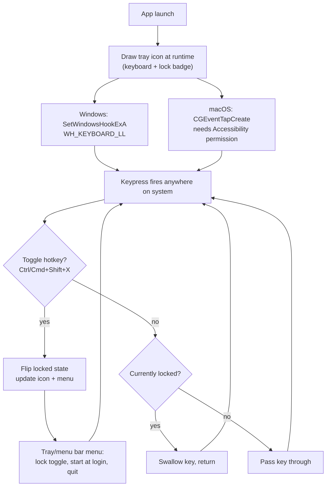

<h1 align="center">klock: a tiny cross-platform keyboard locker</h1>

<p align="center">Block your physical keyboard while it's tucked under a notebook, a tablet, or anything else.</p>

## What it does

`klock` sits in your menu bar / system tray and, when locked, swallows every keystroke system-wide until you press the unlock combo again. Useful if you write with a notebook resting on your laptop and don't want stray keys firing while you write.

- **Windows**: `Ctrl+Shift+X` toggles lock/unlock
- **macOS**: `Cmd+Shift+X` toggles lock/unlock
- Tray/menu bar icon shows current state (keyboard glyph with a lock badge — red when locked)
- Right-click (Windows) / click (macOS) menu with manual lock toggle, optional "start at login," and quit
- No image assets — both the tray icon and the macOS app icon are drawn at runtime/build time in code
- Single-purpose, no telemetry, no network access

## Why C++

Efficient binary size and direct access to each platform's native low-level input APIs (`SetWindowsHookEx` on Windows, `CGEventTapCreate` on macOS) without a runtime or framework in the way.

## Architecture



## Platform notes

### Windows

- Global low-level keyboard hook via `WH_KEYBOARD_LL`
- Tray icon drawn at runtime with GDI (`CreateDIBSection`, `RoundRect`, `CreateIconIndirect`) — no `.ico` file needed
- Right-click tray icon for the menu

Build:
```
make release
```
Produces `klock.exe`. Run it directly — no installer needed.

### macOS

- Global event tap via `CGEventTapCreate` (Objective-C++, `klock_mac.mm`)
- Menu bar icon drawn at runtime with `NSBezierPath`/Core Graphics
- App icon (`.icns`) generated at build time from the same design by a small standalone tool (`gen_icon.mm`), packed with `iconutil`
- Packaged as a proper `.app` bundle so macOS treats it as a real application (required for the "start at login" toggle, which uses `SMAppService`)

Build:
```
make bundle
```
Produces `Klock.app`. Drag it to `/Applications` and open it once.

You'll need to grant Accessibility permission the first time: **System Settings → Privacy & Security → Accessibility → enable Klock**. This is required by macOS for any app that intercepts system-wide keyboard events — it's not optional and not something the app can skip.

If Klock is in the menu bar but shows **Permission needed**, click it to open the right settings page. If Klock is already listed there but does nothing (this can happen after an update on older builds), select it, press **−** to remove it, then add it again.

"Start at login" is opt-in from the menu — it does not register itself automatically on first run.


## License
MIT
